<p align="center">
  
</p>

<p align="center">
  
  
  
  
  
</p>

<p align="center"><b>A Fabric mod that makes the sky more interesting.</b><br>
High above the clouds float the villages of the Cirri, a people who fly on veils of woven cloud and never touch
the ground.<br>Wild islands drift past, koi swim through the air, and now and then a great Cloud Whale goes by, singing.</p>

<p align="center">
  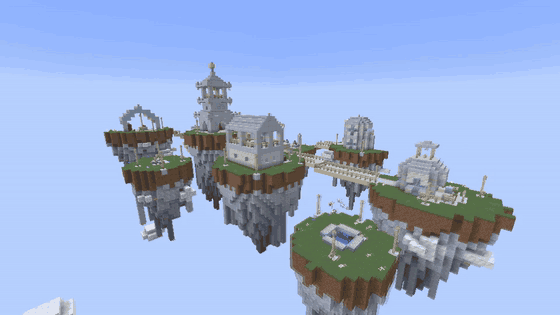
  <br><sub><i>Driftwhistle, one of the Cirri's sky villages.</i></sub>
</p>

---

## The people of the high air

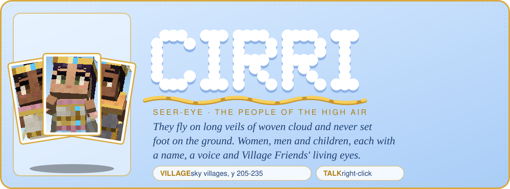

<table>
  <tr>
    <td width="55%">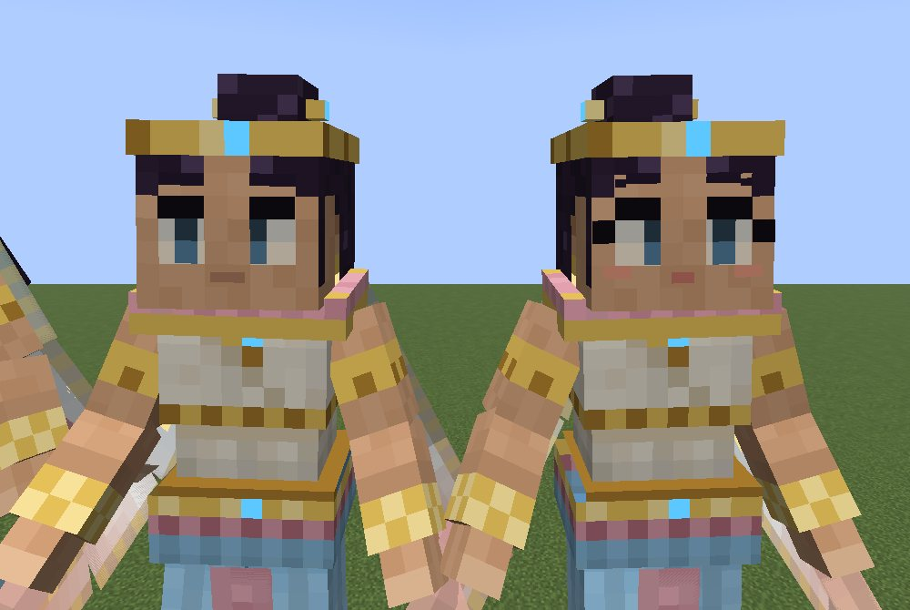</td>
    <td width="45%">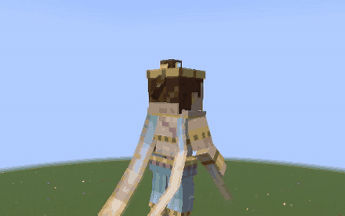</td>
  </tr>
</table>

- **Always flying.** They soar in long swooping arcs, hover upright on the air, and never land. Cruising, they
  stretch out flat with their veils, hair and ribbons streaming behind; hovering, the veils float round them like
  weed in a current.
- **Women, men and children**, each with a name, a look (three complexions, four outfits) and a voice: wordless
  humming, a greeting when they turn to you, cries when hurt.
- **Living eyes**, the same as Village Friends villagers': two eye styles, blinking, glances and eye contact.
- **A day in the village.** At night they sleep floating over the cushions of their nests. By day they work (the
  harpists play the wind harps, the bellkeeper rings the bell at dawn and dusk, the weavers weave, the gardeners
  tend the koi), gather at the Veil Court, and soar round their islands.
- **Families.** Couples share a nest; now and then at dawn a baby is born, who keeps close to its mother.
- **The Skymerchant** trades Cirri goods for emeralds, including the Cirrus Veil and the Windsong Flute.
- **Music.** Play a wind harp or a Windsong Flute and the Cirri nearby come to listen. Hit one and it flies away.

## Talking with the Cirri

Right-click a Cirri to talk. The conversation window (Village Friends' layout, in the colours of a clear sky) shows
their portrait and mood bubble, their line typing out in a breath of flute, numbered replies, and your friendship as
ten little clouds filling with gold, from **Walker** to **One Sky**.

<table>
  <tr>
    <td width="50%">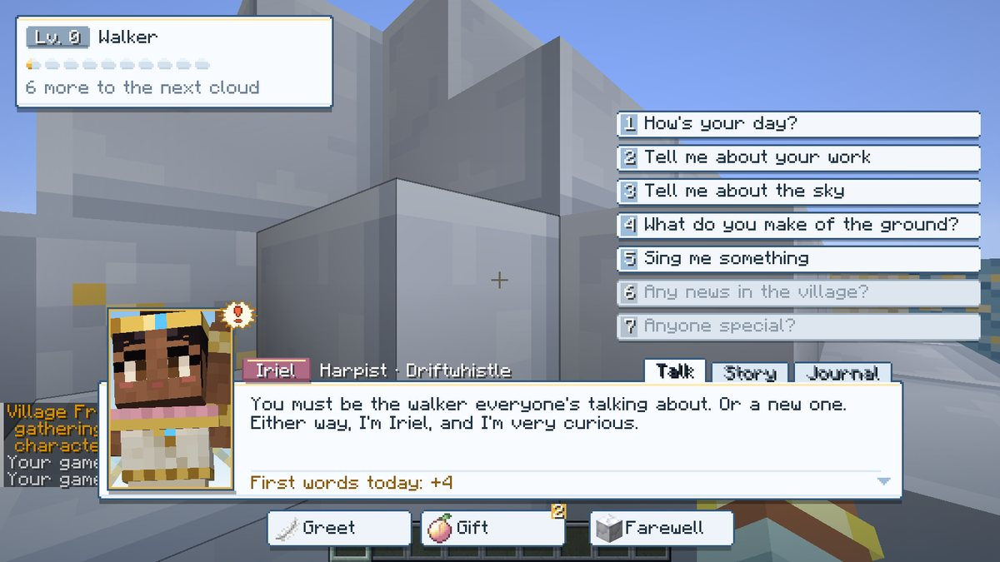<br><sub>Iriel the harpist meets a walker.</sub></td>
    <td width="50%">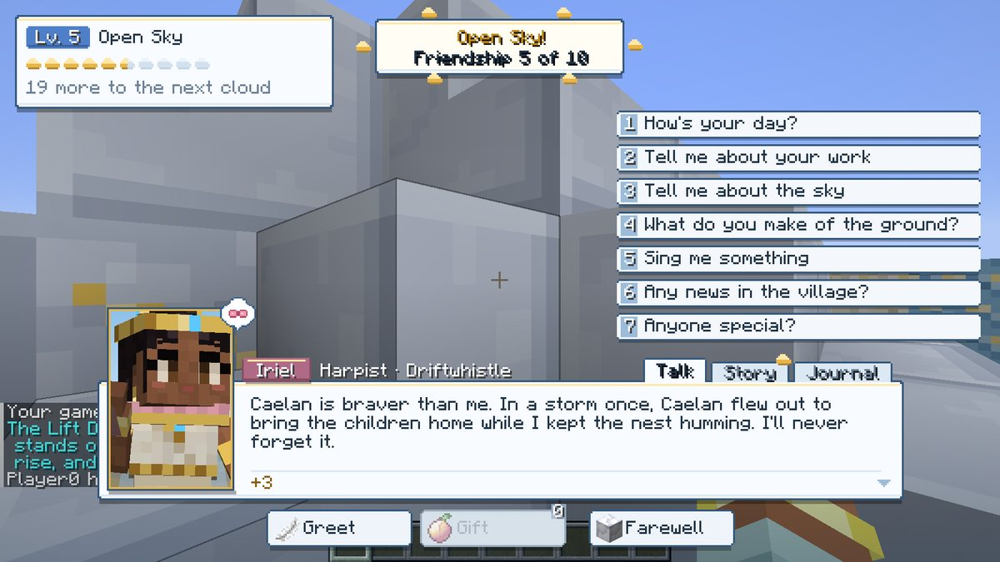<br><sub>Open Sky: friendship five of ten.</sub></td>
  </tr>
  <tr>
    <td width="50%">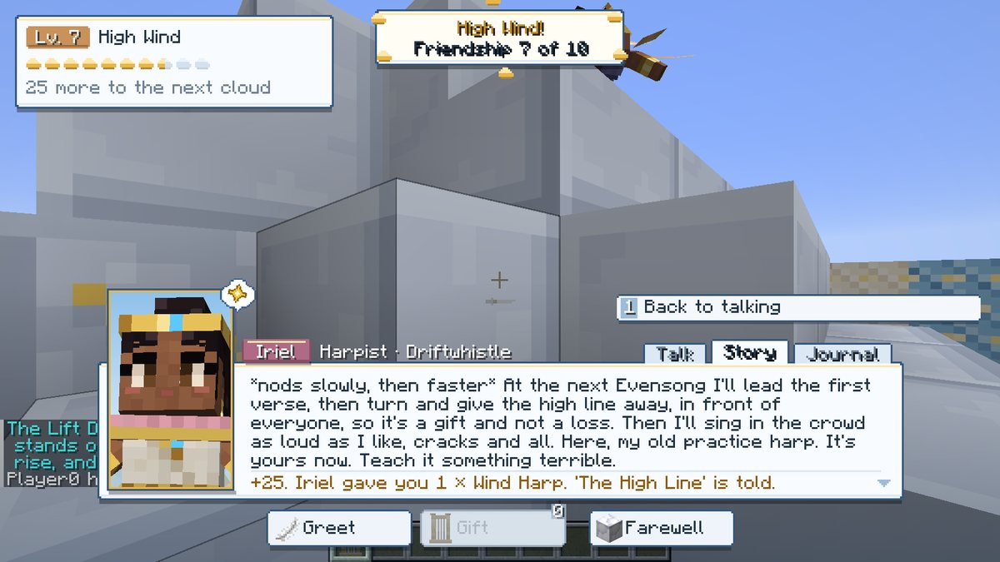<br><sub>Her story told, she gives you a wind harp.</sub></td>
    <td width="50%">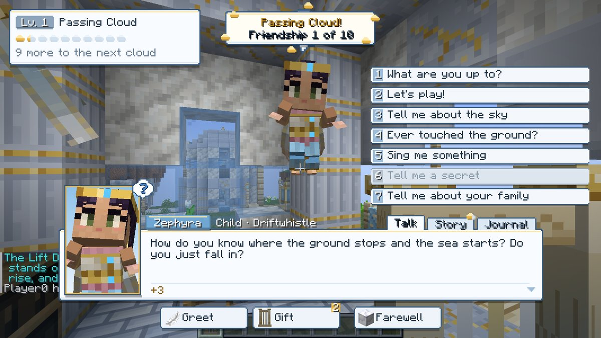<br><sub>Children ask their own questions.</sub></td>
  </tr>
</table>

- **About 5,500 hand-written lines**, chosen for the moment as Village Friends' are: the hour, the weather and the
  wind that has the sky today (Aure, Sefa, Vell or Borre), the moon, what they were doing, their personality (nine for
  grown-ups, six for children) and job, how well they know you, what you hold and how you look (soaked, hurt, wearing
  an elytra or a Cirrus Veil, standing at the edge of the island), what's near (a Cloud Whale, koi, a wind harp) and
  what you've told them.
- **Replies:** How's your day? · Tell me about your work · Tell me about the sky · What do you make of the ground? ·
  Sing me something · Any news in the village? (at Fair Wind) · Anyone special? (at Open Sky). Children: play, the
  sky, the ground, songs, secrets and their family.
- **Questions:** now and then they ask you something (86 questions: favourite wind, have you ever fallen, cats or
  koi...) and remember your answer, calling back to it later. **Offers:** they patch you up when you're hurt, give you
  a sky peach when you're hungry, wrap you in a breath of wind at the edge, mend your elytra, tell you the way down.
- **Gifts** they love, like or don't (two a day), **stories** of their own (25 for grown-ups with three requests and
  two endings, 10 for children), and **the Journal**: your memories together, what you know of them, their story so far.
- **Gossip** about real neighbours: who shares a nest with whom, whose baby was born, who grew up, the whale that
  passed, the storm, what you did.
- **Manners:** they hover in front of you as you talk; the shy keep further off, the restless drift round you, the
  merry dart off for a loop and come back, the busy excuse themselves. Strike one and they turn away until you say sorry.

## A village going about its day

<p align="center">
  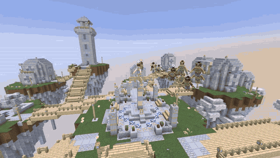
  <br><sub><i>At dusk the whole village circles over the Veil Court to sing the Evensong.</i></sub>
</p>

- The village's **name** comes up as you arrive. **Emote bubbles** (little clouds) pop over their heads: hearts between
  sweethearts, notes as they sing, "..." as they chat, "Zz" asleep.
- Neighbours stop in pairs to **chat** face to face. When a **Cloud Whale** passes, some fly out to swim beside it.
  Children play **tag**. In thunder everyone **shelters** in their nests.
- Close friends wave you over with a heart and once a day fly over with a **little present**.
- **126 animation clips**: idles and trades (harpists strumming, weavers combing cloud), loops and somersaults, waves
  and bows, gestures as they talk, delight, thanks and huffs.

<table>
  <tr>
    <td width="33%">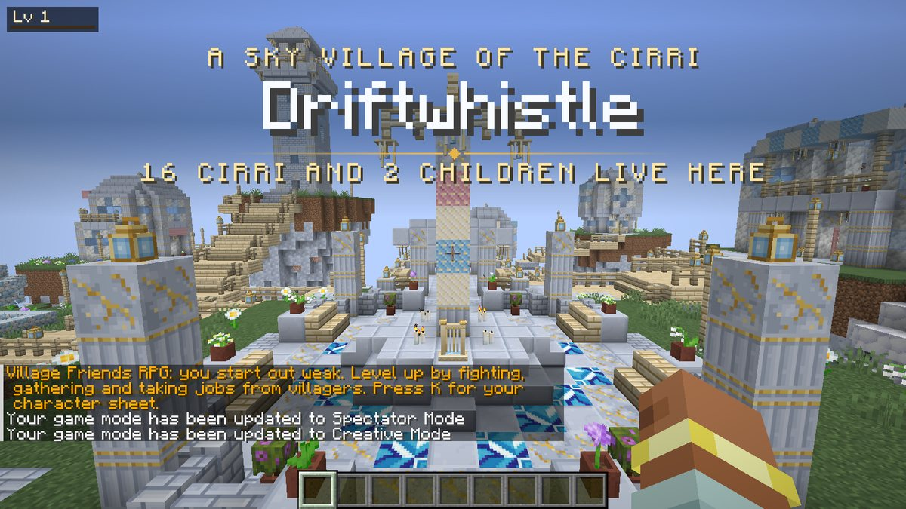<br><sub>Arriving at Driftwhistle.</sub></td>
    <td width="33%">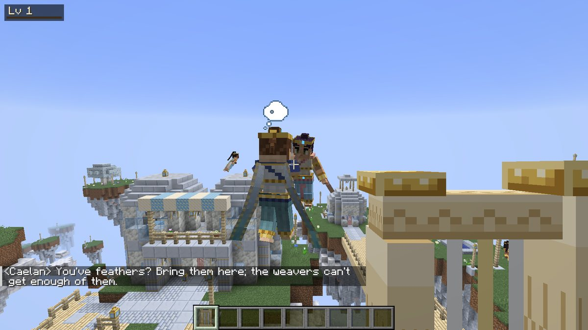<br><sub>Neighbours stop to chat.</sub></td>
    <td width="33%">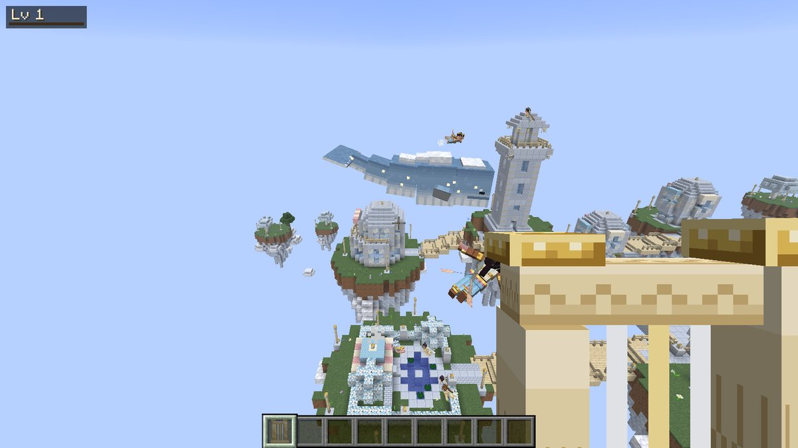<br><sub>Flying out to meet a whale.</sub></td>
  </tr>
</table>

## The sky

<table>
  <tr>
    <td width="50%">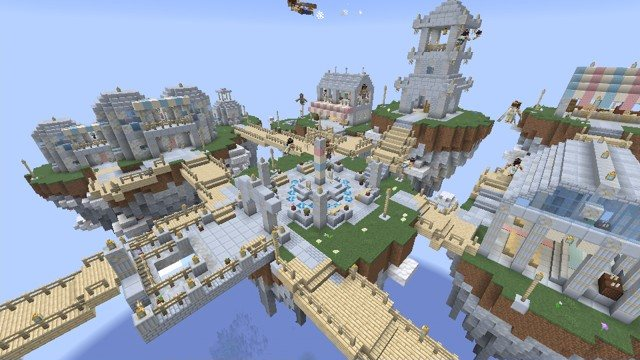</td>
    <td width="50%">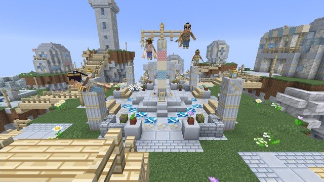</td>
  </tr>
  <tr>
    <td width="50%">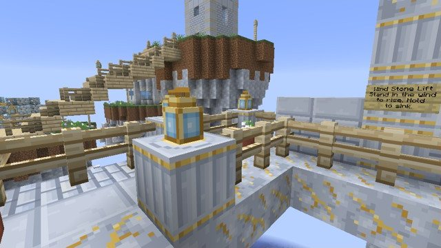</td>
    <td width="50%">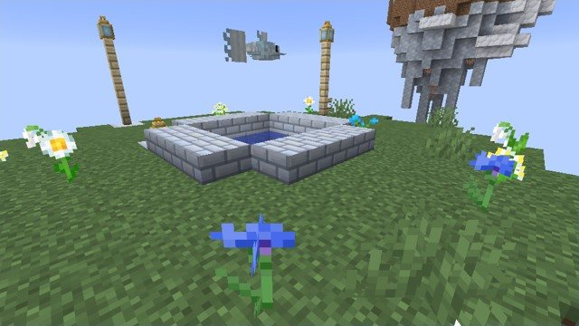</td>
  </tr>
</table>

- **Sky villages** float at about y 205-235: a central island with the Veil Court, a Bell Pagoda, the Hall of
  Echoes, a Loom House, a Cloud Garden with a koi pool, a Market Pavilion, a Lantern Spire and the Cirri's nest
  houses, each on its own islet, joined by skywood bridges.
- **The wind lift.** Straight under each village's Lift Dock, on the ground, stands a **Wind Stone** in a ring of
  skystone. Stand in its wind and it lifts you up to the dock; on the dock, step into the shaft and hold sneak to
  sink gently back down.
- **Wild sky islets** with skywood trees and flowers, some with a koi pond; **Wind Shrines** with a wind harp and a
  chest of Cirri goods; **Ruined Belltowers**, broken and overgrown, with a fallen bell and a chest.

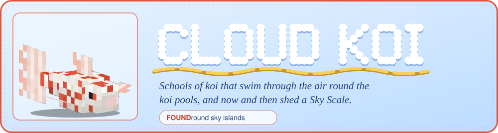
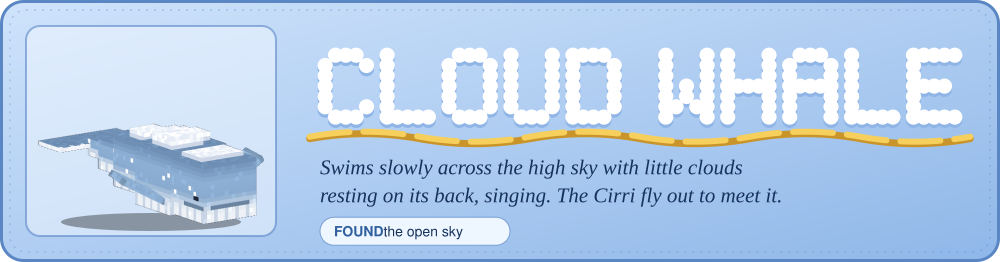

## Blocks and items

Skystone (with bricks, polished, gilded and pillar forms, stairs, slabs and a wall), cloud blocks (nothing that
lands on cloud takes fall damage), skywood (logs, planks, stairs, slabs, fences, gates, blossoming leaves and
saplings that grow skywood trees), veilcloth in white, sky and rose (and carpets), wind chimes (they ring in the
wind and the rain), wind harps, sky lanterns, and the Wind Stone. Items: Sky Scales, Sky Peaches, the Windsong
Flute and the Cirrus Veil (wear it and you glide gently whenever you fall; sneak to drop).

Find a village: `/locate structure skyfriends:sky_village`. Spawn eggs and every block are in the Sky Friends
creative tab.

---

## Getting it

```
gradlew build
```

Requires Java 25, Minecraft 26.3, Fabric Loader 0.19.5 and Fabric API 0.161.0+26.3. Sky Friends belongs to the same
modpack as [Village Friends](https://github.com/radhepa/Village-Friends-Minecraft-Mod),
[End Friends](https://github.com/radhepa/EndFriends), [Nether Friends](https://github.com/radhepa/NetherFriends) and
[Cave Expansion](https://github.com/radhepa/CaveExpansion), and works with or without any of them.

## For developers

Everything generated lives in `tools/` (Python 3 with Pillow, numpy and scipy; ffmpeg for the sounds):

| What | How |
|---|---|
| Mob models and textures | `python tools/gen_assets.py` |
| Block textures | `python tools/blocks/textures.py` |
| Block models, loot, tags, recipes, names | `python tools/blocks/gen_blocks.py` |
| Sounds | `python tools/sounds/synth.py` |
| Buildings (previews) | `python tools/buildings/preview.py <name>` |
| Villages and sky structures | `python tools/villages/compile.py` |
| Dialogue (lines, questions, offers) | `python tools/dialogue/dialogue.py` |
| Story books (check) | `python tools/stories/check.py` |
| Animation pack | `python tools/animations/compile.py` |
| Emote bubbles | `python tools/gui/emotes.py` |

The in-game tests:

```
gradlew runClientGameTest -PskyTests=Cirri,Sky,Talk -PtestHeap=2g
```

Add `-PskyFilm` to film them (then `python tools/film.py`), and `-PcompatMods=<a modpack's mods folder>` to run
them inside a modpack. Design notes are in `docs/`: [PEOPLE.md](docs/PEOPLE.md), [VILLAGES.md](docs/VILLAGES.md),
[DIALOGUE.md](docs/DIALOGUE.md) and [ANIMATIONS.md](docs/ANIMATIONS.md).

## License

[MIT](LICENSE). The README art in `docs/readme/` is drawn from the mod's own models and in-game footage.
